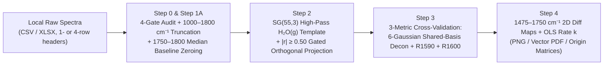

# In-Situ FTIR Processing & Kinetic Quantification Pipeline

[](https://www.python.org/)
[](./INSITU_FTIR_HANDOFF_GUIDE.md)

面向 $\text{CO}_2$–胺液（MEA）程序升温与恒温解吸原位红外（In-Situ FTIR）光谱分析的通用、路径中立、样品无关自动化处理管线。仓库完整开源数据质控、基线校准、气相水汽正交投影去噪、共享物理基底多峰去卷积与动力学线性回归算法（**不包含任何实验原始数据或实验图谱**）。

> 📘 **完整数学模型推导、算法细节与代码映射表**请查阅：[**`INSITU_FTIR_HANDOFF_GUIDE.md`**](./INSITU_FTIR_HANDOFF_GUIDE.md)。  
> 📋 **Origin / Python 作图数据文件与列号一一对应指南**请查阅：[**`验收单.md`**](./验收单.md)。

---

## 1. 算法流程架构（Pipeline Architecture）



---

## 2. 数学模型概要（与源码 1:1 严格对应）

1. **Step 0 & Step 1A：四重自动体检、统一波数截断与中位数水平归零（`scripts/step1A_baseline_truncate.py`）**
   - 自动校验波数有限性与严格单调递增（$\Delta\nu > 0$）、剔除误贴波数列（$\min > 900 \land \max > 3500$）、排查截断域缺失值与重复谱，并核验同一样品升温末帧与恒温首帧在 `[1475.0, 1750.0] cm⁻¹` 的衔接均方根偏差。
   - 统一截取 $\Omega_{\text{1A}} = [999.9,\, 1800.3]\text{ cm}^{-1}$，以无液相吸收锚定窗 $\Omega_{\text{bl}} = [1750.0,\, 1800.0]\text{ cm}^{-1}$ 的中位数平移归零：
     $$b_j = \operatorname{median}_{\nu \in [1750.0,\, 1800.0]} S_j(\nu), \qquad S_{j,\text{1A}}(\nu) = S_j(\nu) - b_j$$

2. **Step 2：带皮尔逊相关门控的气相水汽 $\text{H}_2\text{O}(g)$ 正交投影扣减（`scripts/step2_step3_wvclean_and_ratios.py`）**
   - 自动选取纯气相锚定窗 $\Omega_{\text{anc}} = [1700.0,\, 1800.0]\text{ cm}^{-1}$ 高频标准差最大的尾段均值谱，经 55 点 3 阶 Savitzky–Golay 高通滤波提取 $\text{H}_2\text{O}(g)\ \nu_2$ 精细结构，施加 `<1350 cm⁻¹` 置零与 `[1350, 1365] cm⁻¹` 线性渐变窗，并在 $\Omega_{\text{anc}}$ 上归一化至单位 $L_2$ 范数得到模板 $W(\nu)$。
   - 对每条谱图计算锚定窗内高频相关系数 $r_j$ 与正交投影系数 $\beta_{j,\text{raw}} = \langle S_{j,\text{hp}}, W\rangle_{\Omega_{\text{anc}}}$，仅当 $|r_j| \ge r_{\text{gate}}$（默认 `0.50`）时执行扣减并做二次中位微调归零：
     $$\tilde{S}_j(\nu) = S_{j,\text{1A}}(\nu) - \beta_{j,\text{applied}}\, W(\nu), \qquad S_{j,\text{clean}}(\nu) = \tilde{S}_j(\nu) - \operatorname{median}_{\nu \in [1750, 1800]} \tilde{S}_j(\nu)$$

3. **Step 3：共享 6 峰物理高斯基底去卷积与三指标交叉验证（`scripts/step2_step3_wvclean_and_ratios.py`）**
   - **`decon`（主指标）**：在干净催化窗 $\Omega_{\text{fit}} = [1475.0,\, 1750.0]\text{ cm}^{-1}$ 上，采用跨样品统一的 6 高斯物理基函数 $\{(\mu_k, \sigma_k)\} = \{(1638, 24), (1596, 15), (1566, 15), (1528, 18), (1487, 15), (1438, 18)\}\text{ cm}^{-1}$ 求解箱式约束最小二乘：
     $$\min_{\mathbf{c},\, c_0} \sum_{\nu_i \in \Omega_{\text{fit}}} \left(c_0 + \sum_{k=1}^{6} c_k e^{-\frac{(\nu_i - \mu_k)^2}{2\sigma_k^2}} - S_{j,\text{clean}}(\nu_i)\right)^2 \quad \text{s.t.} \quad c_k \ge 0,\;\; |c_0| \le 0.015$$
     由解析峰面积 $I_k = \sqrt{2\pi}\,c_k\sigma_k$ 计算再生比值 $R_{\text{decon}} = I(1596)/I(1566)$，并同步输出 $R^2_{\text{fit}}$、$\operatorname{RMSE}_{\text{fit}}$ 及残差检验图。
   - **`r1590` 与 `r1600`（对照指标）**：基于 $\pm 2.0\text{ cm}^{-1}$ 窄带均值同步导出 $A(1590)/A(1568)$ 与 $A(1600)/A(1568)$。

4. **Step 4：二维差谱热图与表观再生速率 OLS 回归（`scripts/step4_isothermal_fig4_template.py`）**
   - 对齐各样品恒温起点 $t_0 = 0\text{ min}$，截取共同恒温窗口 $[0,\, t_{\max}]$，按 $\max_s P_{99.5}(|\Delta S_s|) + 0.0005$ 自动设定跨样品共享对称发散色标 `[-vmax, +vmax]`，并通过普通最小二乘（OLS）回归表观再生速率斜率 $k$（$\text{min}^{-1}$）及其标准误、$R^2$ 与 $p\text{-value}$。

---

## 3. 快速开始（Quick Start）

### 安装依赖
```bash
pip install -r requirements.txt
```

### 运行管线
将本地原始 `.csv` 或 `.xlsx` 光谱文件放入 `./raw_data/`（已被 `.gitignore` 严格忽略，不会随 Git 提交），运行：

```bash
python3 run_pipeline.py
```

也可自定义参数独立调用各阶段脚本：

```bash
python3 scripts/step1A_baseline_truncate.py --input-dir ./raw_data --out-dir ./output/step1A
python3 scripts/step2_step3_wvclean_and_ratios.py --in-dir ./output/step1A --out-dir ./output/step2_3 --corr-gate 0.50 --max-hold-min 10.6
python3 scripts/step4_isothermal_fig4_template.py --in-dir ./output/step2_3 --out-dir ./output/step4 --metric all --max-hold-min 10.6
```

---

## 4. 仓库结构

```text
.
├── .gitignore                                # 严格排除 raw_data/、output/ 及所有数据/图像文件
├── README.md                                 # 管线架构、数学模型概要与快速开始
├── INSITU_FTIR_HANDOFF_GUIDE.md              # 完整数学推导、代码逐项映射表与方法规范
├── 验收单.md                                  # 全部输出 CSV 与论文/SI 作图选列一一对应验收指南
├── requirements.txt                          # Python 依赖包清单
├── run_pipeline.py                           # 一键全流程运行入口 (Step 0 -> Step 4)
└── scripts/
    ├── step1A_baseline_truncate.py           # Step 0 四重质控门禁 + Step 1A 截断与中位基线归零
    ├── step2_step3_wvclean_and_ratios.py     # Step 2 相关门控扣水汽 + Step 3 逐帧去卷积曲线导出与三指标定量
    └── step4_isothermal_fig4_template.py     # Step 4 二维差谱热图、OLS 速率回归与 Origin 矩阵导出
```
